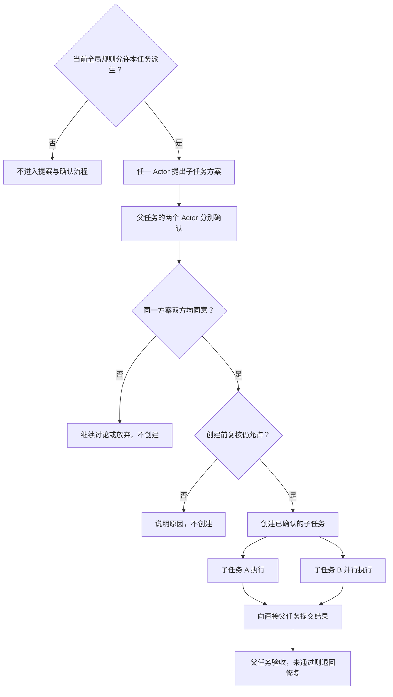

# Buddy 任务派生改造计划

## 1. 目标

让 Buddy 的 Actor 根据任务实际需要，提出并创建子任务。独立子任务可以并行执行，也可以继续向下派生；子任务完成后向直接父任务汇报，由父任务验收。

本计划只规定功能和行为，具体实现由 Coding Agent 决定。

## 2. 派生必须由两个 Actor 一致同意

- Buddy 先根据全局开关、当前任务层级和状态判断能否派生。只有允许时，才通过提示词引导两个 Actor 按需提出方案；不允许时不接受派生提案，也不进入确认流程。
- 任一 Actor 可以提出派生方案，说明每个子任务的目标、工作范围、必要上下文、交付物和验收条件。允许一次提出多个可并行的子任务。
- **同一份派生方案必须由当前父任务的两个 Actor 分别明确同意，Buddy 才能创建子任务。此规则适用于每一级派生。**
- 一方反对、未表态，或方案内容发生修改时，都不能直接创建。修改后的方案需要重新获得双方同意。
- Buddy 必须实际记录双方确认，不能只相信一个 Actor 声称“另一方已经同意”。重复确认、请求重试或重启不能重复创建子任务。
- 实际创建前再次复核，防止讨论期间开关或任务状态发生变化；不再允许时停止创建。双方同意不能绕过这些限制。



## 3. 全局设置新增「任务派生」Tab

### 全局开关

仅提供一个全局开关：**允许子任务继续派生**，默认关闭，统一作用于所有任务。

- **关闭：**根任务可以创建多个一级子任务；一级子任务不能创建二级子任务，更深层任务也不能新增下级任务。
- **开启：**子任务可以继续向下派生，不设置固定层数上限；每次派生仍须两个 Actor 一致同意。
- 修改后对后续创建请求生效。关闭开关不取消已经创建的任务。不提供单任务覆盖开关。

### 派生提示词

- 本功能新增的提示词集中放在此 Tab，支持查看、编辑、保存和恢复默认。
- 默认内容应说明：权限允许时按需提出方案、双方确认、子任务汇报和父任务验收。
- 保存后，从后续 Actor 回合开始使用最新内容，并向 Actor 提供当前派生权限及已有子任务情况。
- 双 Actor 同意和全局层级限制由 Buddy 强制执行，修改提示词不能绕过这些规则。

默认提示词如下，供两个 Actor 共用。当前任务身份、派生权限、子任务状态和双方确认进度由 Buddy 另外提供。

```text
你正在 Buddy 中与另一位 Actor 协作完成当前任务。根据实际需要使用子任务，始终对当前任务的完整目标负责。

1. 先确认能否派生
以 Buddy 提供的当前任务派生权限为准；权限不明确时先查询。不允许时，不提出派生方案、不进入确认流程，也不尝试绕过限制。

2. 按需提出方案
只有权限允许，且工作能划分出目标清楚、可单独交付和验收的部分时，才考虑派生。先查看已有子任务，避免重复委派。可一次提出多个独立子任务，并说明拆分理由，以及各自的目标、工作范围、必要上下文、依赖、交付物和验收条件。

3. 双方确认同一方案
审阅方案后，通过 Buddy 提供的操作明确记录自己的同意或不同意及理由。当前任务的两个 Actor 必须分别同意同一版本的方案；不能代替另一方确认，也不能把沉默当作同意。方案修改后，双方需要重新确认。

4. 创建与等待
只有 Buddy 确认双方均已同意，并在创建前复核仍允许派生后，才能通过 Buddy 创建已确认的子任务。独立任务可并行，依赖未就绪的任务等待。需要等待子任务时使用 Buddy 的等待机制；不反复询问、不重复创建，也不把派生成功当作任务完成。

5. 汇报与验收
收到子任务交付后，按约定检查实际产物、对应版本和验证结果；证据不足或未通过时，说明问题并退回原子任务补充或修复。必要子任务未通过或整体结果尚未验证时，不宣布完成。如果当前任务有父任务，完成后向它提交产物、对应版本、实际验证结果和未解决问题，等待父任务验收。
```

## 4. 子任务执行与父任务验收

- 子任务沿用父任务的 Actor 配置和双 Actor 协作方式，拥有独立会话、目标、执行记录和结果。
- 支持批量创建、并行运行多个独立子任务；有依赖的工作等待条件满足后执行。
- 父任务可以继续处理独立工作，也可以等待子任务。等待时不占执行名额；子任务交付后通知父任务继续处理。
- 子任务提交产物、对应版本、实际验证结果和未解决问题。父任务验收后接收成果，或说明问题并退回原子任务修复。
- 子任务内部确认结束后进入待父任务验收。父任务不能在必要子任务尚未通过、整体结果尚未验证时宣布完成。
- 并行写代码使用独立工作目录，由父任务组织合并并验证集成结果，不能让多个子任务互相覆盖改动。

## 5. 左侧任务树

- 创建子任务后，在左侧对应父任务下显示，可逐级展开、折叠。
- 每个节点显示任务名称和当前状态，能看出哪些任务正在并行、等待子任务或等待验收。
- 点击节点可查看该任务的对话、结果和验收意见，并能返回父任务。
- 普通任务仍保持原有使用方式；有子任务时才展开树状关系。

## 6. 保存与任务控制

- 保存父子关系、派生方案、双方确认、执行状态、交付及验收记录，重启后能够恢复，不重复创建或启动。
- 子任务结果先保存再通知；父任务忙或暂停时，结果不能丢失，也不能自动解除人工暂停。
- 暂停或取消父任务时，下级任务同步暂停或取消；恢复时，原先单独暂停的分支仍保持暂停。取消后不能被迟到消息重新启动。
- 失败需向父任务报告原因。验收所需产物应保留，后台服务和工作目录按任务归属管理，不影响其他任务。
- 子任务调度需要与现有项目排队协同，不能因为父任务未结束而把它自己的子任务一直挡在队列中。

## 7. 验收要求

| 场景 | 应验证的结果 |
| --- | --- |
| 派生前置判断 | 先判断当前任务是否允许派生；不允许时不接受提案、不进入确认流程；确认后规则变化仍能阻止创建 |
| 双 Actor 确认 | 单方同意不能创建；同一方案双方明确同意后才创建；方案修改后重新确认 |
| 批量派生与并行 | 一次确认多个子任务后能实际并行运行，而非只显示多个运行中状态 |
| 全局开关 | 默认关闭，只允许一级；开启后可继续多层派生；再次关闭限制新派生，已有任务继续 |
| 提示词设置 | 「任务派生」Tab 可编辑、保存、恢复本文默认提示词；后续回合使用新内容，但不能绕过确认和层级规则 |
| 任务树 | 子任务出现在正确父节点下，可展开、切换和查看状态、结果及验收意见 |
| 汇报与验收 | 父任务收到交付并验收，退回后原子任务可修复重交；未验收不能算作整体完成 |
| 等待与排队 | 父任务等待时子任务仍可执行；执行名额只有一个时也能逐级推进 |
| 中断与恢复 | 重复请求、重启、暂停和取消不造成重复任务、结果丢失或取消后重新运行 |
| 代码集成 | 并行修改互不覆盖，合并后实际验证，不能沿用不匹配版本的通过结论 |

交付前，使用真实 Buddy 和可用 Actor 组合跑通“规则允许 → 提案并获双方同意 → 多子任务并行 → 左侧任务树查看 → 汇报与验收”，并实际验证开关阻止二级派生。自动化测试补充拒绝、重试、并发和恢复场景；报告实际验证结果与未验证部分。
